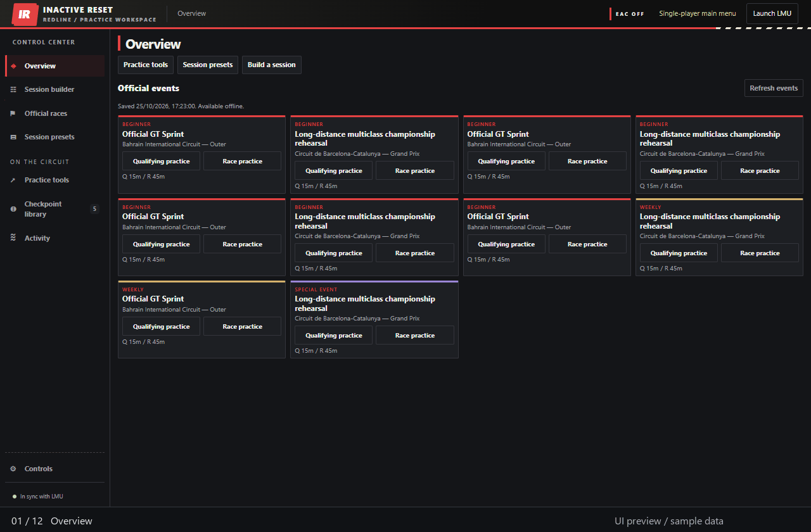

# Inactive Reset

A Windows practice companion for **Le Mans Ultimate**: repeat corners, build local
sessions, and practise official-event conditions.

**[Download for Windows x64](https://github.com/Kyraws/inactive-reset/releases/latest)** ·
[Report a problem](https://github.com/Kyraws/inactive-reset/issues)

## Get started

1. Extract the release ZIP and keep its files together. Run `inactive-reset-ui.exe`
   with Steam running. Requires Windows x64 and
   [WebView2](https://developer.microsoft.com/en-us/microsoft-edge/webview2/);
   no separate .NET installation is needed.
2. Select **Launch local play** and dismiss LMU's **Press any button** screen.
3. Build a session or review a preset, apply it at LMU's single-player main menu,
   then select **Start session** and press **Drive** in LMU once loaded.
4. Capture a starting point in **Practice tools**, select it, and teleport to repeat.
   Garage placement prompts you to press Drive; keep pedals released for moving restoration.

### Choose the right launch mode

**With EAC on: teleporting, tyre preparation and in-session practice rule toggles are DISABLED.**
Use **Launch local play** for these tools. They also require an active **offline,
single-player Practice** session; EAC off alone does not enable them in other modes.

| Capability | Launch local play — EAC off | Launch with EAC — EAC on |
| --- | --- | --- |
| Build/apply/start a local session | Yes, at the single-player main menu | Yes, at the single-player main menu |
| Capture checkpoints | Yes, with valid active-session telemetry | Yes, when LMU exposes valid active-session telemetry |
| Garage teleport and on-track reset | Local single-player Practice only | **Disabled** |
| Prepare tyres and toggle in-session practice rules | Local single-player Practice only | **Disabled** |
| Online racing in LMU | Unavailable | Available through LMU |

**Close LMU completely before switching launch modes.** The app cannot change a
running game's EAC mode. Session-builder rules remain editable at the single-player
main menu in either launch mode. The app never edits multiplayer sessions or registers for or
joins online races. Official-event presets reproduce supported conditions in solo Practice.

## Features

- **Checkpoint capture:** save position, orientation, speed and gear. Quick capture
  replaces a reusable slot; named checkpoints keep individual starts.
- **Teleport with speed and gear:** return through the garage and Drive handoff,
  or use the experimental on-track reset. Moving restoration requires the capture
  car and an eligible straight, approximately level capture.
- **Standing teleport:** start stationary, including from older captures or another
  car's checkpoint on the same track.
- **Circuit maps:** preview checkpoints on LMU's circuit and pit-lane geometry.
  Cached maps and saved checkpoints remain available for offline browsing.
- **Checkpoint library:** filter by circuit/car, mark favourites, rename, copy Quick
  capture into a named checkpoint, delete and undo the latest deletion.
- **Local session builder:** choose owned cars, liveries and circuit layouts;
  configure weekend sessions, start times, race length, AI classes/grid and rules.
- **Weather and track conditions:** edit five forecast points for supported
  sessions, surface conditions and simulation settings, with confirmed game readback.
- **Personal session presets:** save, search, review, update, duplicate and share
  setups through import/export. Review is available offline.
- **Official-event practice:** browse cached daily, weekly and special events;
  review separate Qualifying/Race conditions and apply them to solo Practice.
  See the [supported conditions](docs/LAB.md#official-scheduled-sessions).
- **Garage tyre preparation:** set condition and optional starting heat per wheel,
  directly or during garage teleport, while keeping the fitted compounds.
- **Practice rules and lap repair:** control track-limit enforcement, temporarily
  suppress Flag Rules during garage placement, and repair lap state after teleport.
- **Keyboard and wheel controls:** assign shortcuts and controller buttons for
  capture, teleport, standing teleport and previous/next speed-ready checkpoint.
  Actions require LMU focus.
- **Activity and recovery:** follow progress, cancel operations, filter issues and
  export diagnostics from the fixed dark workspace.
- **Command-line tools:** capture, inspect, plan and place checkpoints, inspect rules,
  or serve the workspace in a browser. Run `inactive-reset.exe --help`.

## App tour

*Overview, all five builder tabs, Official races, Session presets, Practice tools,
Checkpoint library, Activity and Controls. Actual app UI shown with sample data;
the car emblem is loaded from the installed game.*

Reset and moving restoration are experimental and depend on verified engine
layouts. Unsupported game changes disable the affected capability. Fuel, damage
and captured tyre state are not restored. See [limits and recovery](docs/PLACEMENT.md)
and [known issues](docs/STATUS.md).

Back up `data/` before upgrading; keep `data/` and `offsets/` beside the executables.
The unsigned executables may trigger Windows SmartScreen.

[User and technical guides](docs/README.md) · [Build and contribute](docs/CONTRIBUTING.md) ·
[MIT licence](LICENSE) · [Third-party notices](NOTICE)

Unofficial; not affiliated with Studio 397, Motorsport Games or the ACO.
